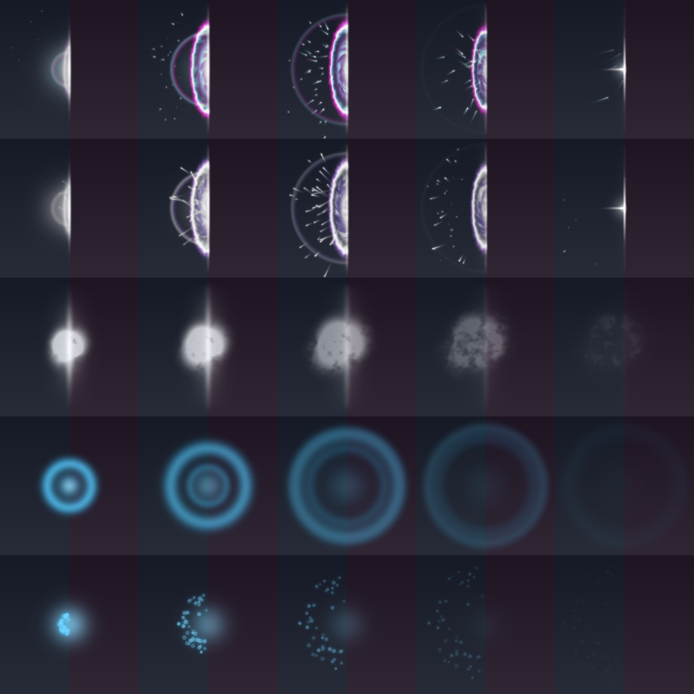

<div align="center">

# monswitch

**Switch your monitor between computers – from the keyboard, the menu bar or the command line.**

Monitor inputs and Picture-by-Picture over DDC/CI, a software KVM for split-screen mode,
an edge effect when the cursor crosses over, and one-click streaming between the machines.
Windows and macOS.

[](https://github.com/marianmolnar/monswitch/actions/workflows/build.yml)
[](LICENSE)




<sub>The edge transition effect: <i>rift</i> (default; the cursor leaving, then entering), <i>smoke</i>, <i>glow</i> and <i>particles</i>.</sub>

[Czech version / Česky](README.cs.md)

</div>

---

## What it does

You have one monitor and two computers – say a desktop PC on DisplayPort and a laptop on
USB-C. Monitors can switch inputs, but only through a clumsy on-screen menu. monswitch talks
to the monitor directly over **DDC/CI** (the same channel the OSD settings use) and adds what
the monitor cannot do by itself:

| | |
|---|---|
| 🖥️ **Input switching** | Global hotkeys, a tray / menu-bar app and a CLI. Usually works from the computer that is not on screen, too. |
| ◫ **PiP / PbP** | Turn Picture-in-Picture or side-by-side mode on and off and pick the second source (monitor presets). |
| ⌨️ **Software KVM** | In side-by-side mode one keyboard and mouse move across both halves with a shared clipboard ([Deskflow](https://github.com/deskflow/deskflow), started and stopped automatically). |
| ✨ **Edge effect** | A short burst of mist and light where the cursor leaves one computer and enters the other. |
| 📺 **Streaming** | One click to see the other computer in a window or play games from it ([Sunshine](https://github.com/LizardByte/Sunshine) + [Moonlight](https://moonlight-stream.org)). |

Everything is configured in one TOML file and a small settings window.

## Will it work with my monitor?

**Input switching: very likely.** Almost every desktop monitor from the last decade supports
DDC/CI and the standard MCCS *Input Select* code (VCP `0x60`). monswitch ships with the
standard values (DisplayPort 1/2, HDMI 1/2); `monswitch caps` shows which values your monitor
actually accepts.

Things that can get in the way:

- **DDC/CI is off** in the monitor's OSD – turn it on.
- **USB-C / Thunderbolt inputs have no standard value.** It is usually `0x1A` or `0x1B` –
  `monswitch caps` lists the candidates, `monswitch input 0x1B` tries one.
- **Docks, hubs, KVM switches and DisplayLink adapters** often do not pass DDC/CI through.
  Connect the monitor directly.
- **Macs:** Apple Silicon over USB-C / Thunderbolt / DisplayPort works. The built-in HDMI port
  of some Macs does not pass DDC/CI.
- **A few models** ignore `0x60` or switch only with vendor-specific commands. Those are not
  supported yet – please [open an issue](../../issues/new?template=monitor-report.yml).

**PiP / PbP: needs a preset.** There is no standard code for split-screen modes; every vendor
uses its own. monswitch includes presets for tested monitors and a probe tool to find the
codes on yours ([how](#finding-pip--pbp-codes-for-your-monitor)).

| Monitor | Inputs | PiP / PbP | Preset |
|---|:-:|:-:|---|
| ASUS ROG Swift PG27UCDM | ✅ | ✅ | `asus-pg27ucdm` |
| *your monitor?* | | | [report it](../../issues/new?template=monitor-report.yml) |

## Install

### Download

Installers for Windows (`.exe`, `.msi`) and macOS (`.dmg`, Apple Silicon) are attached to every
[release](../../releases). The macOS app is not signed: the first time, right-click it →
**Open**.

### Build from source

<details>
<summary><b>Windows</b></summary>

1. [Visual Studio Build Tools](https://visualstudio.microsoft.com/downloads/) with the
   *Desktop development with C++* workload, [Rust](https://rustup.rs) and
   [Node.js](https://nodejs.org) 20+.
2. Build:
   ```powershell
   cargo install --path crates/cli        # the `monswitch` command
   cd apps/tray
   npm install
   npx tauri build                        # installers in target/release/bundle/
   ```
</details>

<details>
<summary><b>macOS (Apple Silicon)</b></summary>

```sh
xcode-select --install
curl --proto '=https' --tlsv1.2 -sSf https://sh.rustup.rs | sh
brew install node
cargo install --path crates/cli          # the `monswitch` command
cd apps/tray && npm install && npx tauri build
```
The app is in `target/release/bundle/macos/`, the disk image in `target/release/bundle/dmg/`.
</details>

## Quick start

```sh
monswitch list                 # monitors that answer DDC/CI, current input
monswitch caps                 # what the monitor supports, input values with aliases
monswitch input hdmi1          # switch (alias from the config, or a raw value: input 0x1B)
monswitch config preset        # built-in monitor presets
monswitch config preset asus-pg27ucdm
```

Then start the **tray app**, open **Settings…** and adjust:

1. **Inputs** – aliases and values (`monswitch caps` shows the right ones).
2. **Computers in the menu** – a name, an input and a global shortcut per computer
   (default <kbd>Ctrl</kbd>+<kbd>Alt</kbd>+<kbd>Shift</kbd>+<kbd>1</kbd> / <kbd>2</kbd>;
   on a Mac <kbd>⌃</kbd><kbd>⌥</kbd><kbd>⇧</kbd><kbd>1</kbd> / <kbd>2</kbd>).
3. **Start at login**.

Install monswitch on both computers – each one can switch the monitor (on most monitors even
when it is not the one being shown).

## Command line

| Command | What it does |
|---|---|
| `monswitch list` | Monitors, backend, model, current input (`*` = the one selected by the config) |
| `monswitch caps [--raw]` | Parsed capabilities string, input values with aliases |
| `monswitch input [alias\|value]` | Switch input, or show the current one |
| `monswitch pbp [on\|off\|toggle]` | PbP side by side (shows the state without an argument) |
| `monswitch pbp pip [1-4]` | Picture-in-picture in a corner |
| `monswitch pbp source <alias>` | Source of the second window |
| `monswitch get <codes…>` / `set <code> <value>` | Raw VCP access (codes in hex: `60`, `0x60`) |
| `monswitch probe -o a.json` | Snapshot of the manufacturer-specific VCP range |
| `monswitch probe --diff a.json b.json` | What changed between two snapshots |
| `monswitch probe --cycle-inputs` | Try every input value the monitor lists, then go back |
| `monswitch config [path\|show\|init\|preset]` | Config file helpers |

Global options: `-m/--monitor <index|model>`, `--config <file>`, `-v` / `-vv`.

## Finding PiP / PbP codes for your monitor

Vendors hide split-screen control in the manufacturer range of VCP codes (`0xE0`–`0xFF`).
`monswitch probe` reads that whole range so you can see what the OSD changes:

```sh
monswitch probe -o off.json          # PiP/PbP off
# turn PbP on in the monitor's OSD
monswitch probe -o pbp.json
monswitch probe --diff off.json pbp.json
```

The code that changed is the mode. Repeat with PiP and with a different second source to find
the values, then put them into the config:

```toml
[pbp]
mode_code    = 0xF4   # VCP code of the PiP/PbP mode
off          = 0      # value: off
pip          = 4      # value: picture-in-picture
pbp          = 5      # value: side by side
source_code  = 0xF5   # second window's source (optional)
source_shift = 8      # source value = input value << shift
```

Got it working? Add a preset (`crates/ddc-core/presets/<vendor>-<model>.toml`) in a pull
request, or paste your findings into a [monitor report](../../issues/new?template=monitor-report.yml).

## Software KVM in PbP mode

With both computers side by side on one monitor, the monitor's built-in KVM gives the USB
keyboard and mouse to only one of them. monswitch runs [Deskflow](https://github.com/deskflow/deskflow)
so the cursor simply moves across the middle of the screen, with a shared clipboard:

- the **server** (the computer that has the keyboard and mouse in PbP) runs Deskflow only while
  PiP/PbP is on – it checks the monitor every 3 s, so it follows changes made from the OSD or
  the other computer too;
- the **client** keeps Deskflow running and waits.

**Setup, once:**

1. Install Deskflow on both computers (`winget install Deskflow.Deskflow`;
   macOS: [releases](https://github.com/deskflow/deskflow/releases)).
2. In the Deskflow app: the server computer is *Server*, with the other screen placed the same
   way as on the monitor; turn on clipboard sharing. The other computer is *Client*. Accept the
   TLS fingerprint on both sides and check that the cursor crosses over.
3. **Close the Deskflow app and disable its autostart** (on Windows also set the *Deskflow*
   service to Manual) – monswitch starts the core itself.
4. monswitch → Settings → **Software KVM**: role *server* on one computer, *client* on the other.

On macOS Deskflow needs *Accessibility* and *Input Monitoring* permission.

### Edge transition effect

When the cursor crosses to the other computer, a small burst of mist and light appears where it
left and where it entered. monswitch reads Deskflow's log (`switch from "A" to "B" at x,y`),
shows the effect on the server and tells the client over UDP (port `24810`; the client finds the
server by itself). The overlay is a native transparent window that never takes clicks or focus.

Settings → *Edge transition effect*: style (`rift`, `smoke`, `glow`, `particles`), duration, color.
Windows may ask about the firewall on first start – allow private networks.

## Streaming

To see the other computer in a window, or to play games from a gaming PC on a laptop,
monswitch starts [Moonlight](https://moonlight-stream.org) streams to
[Sunshine](https://github.com/LizardByte/Sunshine) on the other computer.

1. Install Sunshine on the computer you want to see and Moonlight on the one you look from:

   | | Windows | macOS |
   |---|---|---|
   | Sunshine | `winget install LizardByte.Sunshine` | `brew tap LizardByte/homebrew && brew install lizardbyte/homebrew/sunshine` |
   | Moonlight | `winget install MoonlightGameStreamingProject.Moonlight` | `brew install --cask moonlight` |

2. Open the Sunshine web UI (`https://localhost:47990`) and create the admin login. macOS: allow
   `sunshine` under *Privacy & Security → Screen Recording* and *Accessibility*.
3. Pair once: in Moonlight add the other computer, then enter the PIN in Sunshine's web UI.
4. monswitch → Settings → **Streaming**: fill in the **host** (the name Moonlight shows) of each
   profile. The menu then has *Stream: Other computer (window)* and *Stream: Game (fullscreen)*.

Profiles are plain Moonlight options (`--resolution`, `--fps`, `--video-codec`, … – see
`Moonlight stream --help`). `--resolution native` uses the native resolution
of a MacBook's built-in display.

**Sunshine on demand:** monswitch can start and stop Sunshine from the menu (*Sunshine – share this
screen*) or together with itself. On Windows Sunshine is a service that regular users may not start;
click **Allow** once in Settings → Streaming (one UAC prompt, it grants start/stop for that service
only). On macOS a Homebrew Sunshine is controlled with `brew services`.

## Configuration

The config file is created on first start:

- Windows: `%APPDATA%\monswitch\config.toml`
- macOS: `~/.config/monswitch/config.toml`

Every key is documented in the [default config](crates/ddc-core/default_config.toml); missing
keys fall back to it. The settings window edits the same file and keeps your comments.

## Troubleshooting

<details>
<summary><b><code>monswitch list</code> finds nothing</b></summary>

Turn DDC/CI on in the OSD, connect the monitor directly (no dock), try another cable. On
Windows update the GPU driver; with NVIDIA cards monswitch falls back to NVAPI automatically
when the standard API cannot read the monitor.
</details>

<details>
<summary><b>The monitor disappears for a moment after a PiP/PbP change</b></summary>

Normal – the OS re-detects it. monswitch waits up to `[ddc].rediscover_timeout_ms` (8 s) for it.
</details>

<details>
<summary><b>A shortcut stopped a key from typing</b></summary>

On Windows <kbd>Ctrl</kbd>+<kbd>Alt</kbd> is <kbd>AltGr</kbd>, so on many keyboard layouts
<kbd>Ctrl</kbd>+<kbd>Alt</kbd>+<kbd>1</kbd> types a character. The settings window flags such
shortcuts; add <kbd>Shift</kbd>.
</details>

<details>
<summary><b>The cursor stutters on the client computer</b></summary>

The KVM sends mouse movement over the network. Wi-Fi with power saving (on Macs also AirDrop /
Handoff scanning) adds latency spikes – a cable or 5 GHz Wi-Fi close to the router helps.
</details>

Logs: run the tray app from a terminal with `RUST_LOG=debug`.

## How it works

```
crates/ddc-core   DDC/CI on top of ddc-hi: one worker thread, per-command timeout + retry,
                  50 ms between commands, capabilities parser, config, presets, probe/diff
crates/cli        the `monswitch` command
crates/kvm        runs deskflow-core (server only in PbP) and parses its log
crates/effect     edge effect: UDP link, cursor trail, native overlay
                  (Windows: layered window + software renderer, macOS: Core Animation)
crates/stream     Moonlight profiles, Sunshine on/off
apps/tray         Tauri 2 tray / menu-bar app (React + TypeScript + Tailwind)
```

`cargo test` runs without a monitor; `cargo run -p effect --example burst -- rift` shows the
effect on Windows.

## Contributing

Monitor reports and presets are the most useful contributions – they make monswitch work for
everyone with the same model. Bug reports and pull requests are welcome too; CI runs tests and
`clippy -D warnings` on Windows and macOS.

## License

[MIT](LICENSE)
